<!--
  ╔═══════════════════════════════════════════════════════════════╗
  ║  JOSH14MAX // profile README                                  ║
  ║  Assets: ./assets/*.svg (text vectorised, no external fonts)  ║
  ║  Snake:  .github/workflows/neon-snake.yml -> branch "output"  ║
  ╚═══════════════════════════════════════════════════════════════╝
-->

  

  <b>DevOps apprentice by day, vibe-coder by night.</b> 
  I build the pipes — containers, clusters, CI/CD — then I ship the products that flow through them.

 


  

 


  

 


  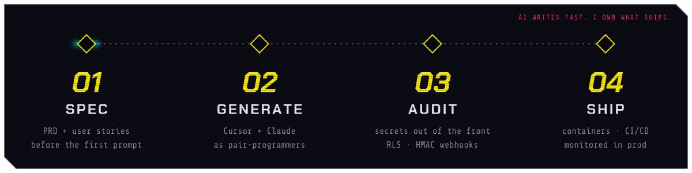

 


  <a href="https://nghair.link">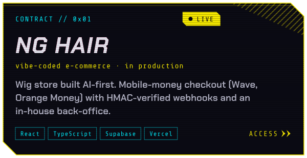</a>
  <a href="https://github.com/josh14max?tab=repositories">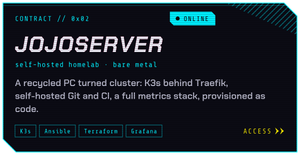</a>

  <a href="https://github.com/josh14max/aspire-create-launch">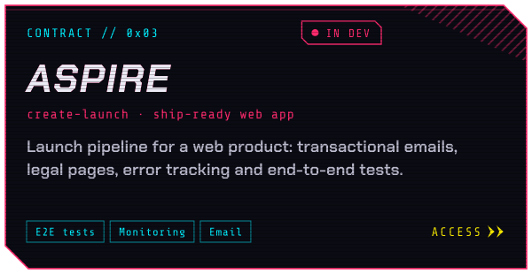</a>
  <a href="https://github.com/josh14max?tab=repositories">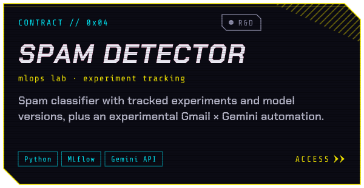</a>

 


  <picture>
    <source media="(prefers-color-scheme: dark)" srcset="https://raw.githubusercontent.com/josh14max/josh14max/output/snake-dark.svg" />
    <source media="(prefers-color-scheme: light)" srcset="https://raw.githubusercontent.com/josh14max/josh14max/output/snake-light.svg" />
    
  </picture>

 


  <!-- ⚠️ remplace TON-PROFIL-LINKEDIN et TON-EMAIL avant de publier -->
  
  <a href="mailto:TON-EMAIL">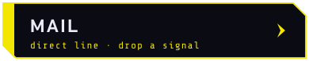</a>
  <a href="mailto:TON-EMAIL?subject=Freelance%20vibe-code">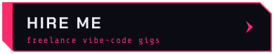</a>

 

  

